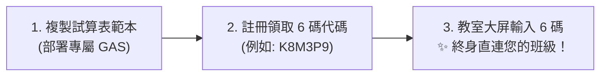
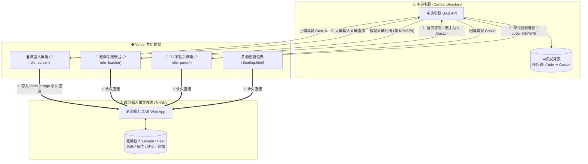

# 🏫 智慧大屏班務與課堂座位管理系統 (Smart Classroom & Seating Board)

> 專為中小學智慧黑板、觸控大螢幕、平板與手機量身打造的**新一代全方位智慧教室助手**。  
> 整合 **Google 試算表（私有資料庫）+ Gemini Vision AI（視覺辨識）+ 6 碼代碼直連電話簿 + 跨螢投屏 + 角色頭像引擎**，讓班務管理、座位編排與親師溝通達到前所未有的極致流暢！

---

## 🌟 為什麼選擇這套系統？（教學現場 5 大痛點一次解決）

| 痛點 | 傳統做法 | 智慧大屏班務系統做法 |
| :--- | :--- | :--- |
| **教室大屏輸入困難** | 沒有實體鍵盤、滑鼠，在觸控大屏上戳又長又臭的網址常打錯。 | **🔑 6 碼英數代碼**：大字體觸控輸入 6 個字（如 `K8M3P9`）即刻直連，終身免再設定！ |
| **開學座位表拍照耗時** | 老師一張張傳到電腦、手動裁剪、手動對號碼改檔名，至少花 2 小時。 | **📸 白紙 AI 自動配對**：學生舉座號白紙，老師持手機巡視連續快拍，Gemini AI 零秒辨識自動歸位！ |
| **學生個資顧慮與頭像缺漏** | 學生請假缺拍照只能留灰色問號；或家長不希望孩子真實照片投影上大屏。 | **🎨 一鍵變身角色頭像**：內建 8 種經典風格（Q版冒險家/機器人/像素風），依座號自動運算專屬造型！ |
| **聯絡簿抄寫與缺交追蹤** | 幹部抄黑板字跡不清；各科小老師缺交單滿天飛，銷案常搞丟紀錄。 | **🎙️ 語音/手寫 AI 轉文字 + 缺交膠囊**：口述即成條目，大屏點擊膠囊一秒完成銷案！ |
| **親師溝通與隱私安全** | 各班名單放外部伺服器有資安風險；家長查作業要密碼登入或一直私訊問老師。 | **🔒 私有試算表 (BYOK)**：資料 100% 存在老師個人 Google 雲端，家長點專屬短連結即時查詢。 |

---

## 🌐 系統正式線上入口（即開即用，免註冊）

系統採用統一前端設計，預設已連線至公共展示沙盒，點開即可立即體驗：

| 介面視圖 | 專屬入口網址 (Click to Open) | 核心特色與使用場景 |
| :--- | :--- | :--- |
| 🖥️ **教室大屏主控端** | [👉 進入大屏班務系統](https://screenclassmanagement.vercel.app/?role=screen) | 專為智慧黑板/觸控大屏設計：黑板自由板書畫布、今日課業看板、缺交膠囊銷案、課堂抽籤拉霸機、計時器、碼表。 |
| 🪑 **動態排座與拍照系統** | [👉 進入座位表系統](https://screenclassmanagement.vercel.app/Seating.html) | 動態網格拖曳排座、走道規劃、A4 單頁列印、AI 白紙快拍歸位、DiceBear 向量角色頭像中心。 |
| 📱 **教師行動管理端** | [👉 進入教師手機後台](https://screenclassmanagement.vercel.app/?role=teacher) | 老師隨堂巡視專用：語音辨識新增作業、拍照辨識板書、一鍵複製家長專用短連結、推送大屏設定。 |
| 👨‍👩‍👧 **家長手機查詢端** | [👉 進入家長查詢系統](https://screenclassmanagement.vercel.app/?role=parent) | 學生座號 + 密碼簡易登入：即時檢視每日聯絡簿記事、確認個人是否有缺交作業未銷案。 |

> 💡 **溫馨提醒**：網頁已全數響應式（RWD）優化，支援直式手機、橫向平板、觸控黑板與桌上型電腦。

---

## 🚀 老師 3 分鐘快速上手（超簡單三步驟）

### 第一步：複製試算表範本並完成部屬
1. 開啟 [試算表範本連結](https://docs.google.com/spreadsheets/d/1HJXwmHmgxBNAXl8P7lDDu2wvO80jyYHSp_On7ddHyaU/copy)（或匯入專案中的 `班級事務系統_Google試算表範例.xlsx`），點擊「建立複本」。
2. 在試算表上方選單點選 **「擴充功能」➔「Apps Script」**。
3. 確認程式碼為最新 [`Code.gs`](file:///c:/Users/huahu/OneDrive/Desktop/大屏班務系統/Code.gs)，點擊右上角 **「部署」➔「新增部署作業」**。
4. 類型選 **「網頁應用程式」**，執行身分選 **「我」**，存取權限選 **「所有人 (Anyone)」**，按下部署並複製結尾為 `/exec` 的專屬網址。

### 第二步：在個人手機或電腦註冊領取「6 碼代碼」
1. 開啟 [系統首頁](https://screenclassmanagement.vercel.app/?role=screen) 或手機端。
2. 點擊頂部功能列的 **「🔑 班級 6 碼代碼」** 按鈕，切換至 **「🚀 2. 註冊新班級」**。
3. 貼上剛才複製的 `/exec` 網址，按下送出。
4. 系統立刻核發您的專屬班級代碼（例如：`K8M3P9`）！

### 第三步：教室大屏輸入 6 碼，立刻開工！
1. 在教室大屏開啟 [大屏網址](https://screenclassmanagement.vercel.app/?role=screen)（建議加入書籤）。
2. 點擊「🔑 班級 6 碼代碼」，在大字體鍵盤輸入 6 碼（如 `K8M3P9`），按下連線。
3. 大屏自動綁定至您的試算表，**Demo 試用按鍵自動消失，正式版啟用完成！**

---

## 🎨 八大教學亮點功能詳解

### 1. 🔑 6 碼極簡代碼連線（查詢一次，終身直連）
- **電話簿架構**：全系統由極速中央名錄驅動，中央名錄**完全不經手任何班級名冊與學生個資**，只負責「6 碼代碼 ➔ 教師試算表」快速映射。
- **家長極簡短網址**：點擊複製家長連結，產生如 `https://your-app.vercel.app/?role=parent&code=K8M3P9`。家長在 LINE 群點開即自動綁定，完全不用手動輸入代碼！

### 2. 📸 白紙拍照 AI 座位配對（開學排座黑科技）
- **操作方式**：學生胸前舉白紙寫座號與姓名，老師拿手機連續快拍。
- **背景智慧壓縮**：前端自動等比壓縮至 < 500KB，零秒連拍不延遲。
- **Gemini 視覺辨識**：後端調用 Gemini Vision 自動讀取數字，圖片直傳 Google Drive，自動寫入座位表試算表。
- **大屏動態聚焦**：大屏每 4 秒自動輪詢新照片，配對成功時觸發**綠色呼吸光環**動態置入座位！

### 3. 🎨 全班學生頭像風格中心（DiceBear 角色引擎）
- **免上傳、高清向量、零個資風險**：採用國際開源 SVG 繪製標準，大螢幕放大投影永不失真。
- **確定性演算**：依據學生「座號」運算造型，同一座號造型永遠固定，不會跳掉。
- **兩種貼心模式**：
  * **僅未拍照者套用**：保留已拍照同學真實照片，未拍照者換上活潑頭像。
  * **✨ 全班一鍵變身卡**：全班強制統一套用指定主題，秒變公仔名冊，教室氣氛瞬間炒熱！
- **8 大熱門風格**：
  * 🧑‍🚀 **Q版冒險家 (`adventurer`)**：日系 RPG 奇幻學生立繪。
  * 🤖 **智慧機器人 (`bottts`)**：超酷科技感金屬機器人。
  * 👾 **復古像素風 (`pixel-art`)**：8-bit 勇者冒險遊戲風。
  * 👍 **微笑拇指人 (`thumbs`)**：元氣陽光笑臉。
  * 🦄 **逗趣小怪獸 (`fun-emoji`)**：萌寵怪獸表情。
  * 🌸 **清新日漫風 (`lorelei`)**：唯美二次元動漫少男少女。
  * 📝 **Notion 手繪風 (`notionists`)**：簡約極簡黑白插畫。
  * 👤 **預設灰階剪影 (`none`)**：標準簡約剪影。

### 4. 🖍️ 雙模式擬真黑板畫布
- **自由書寫**：內建白、黃、粉紅、青綠粉筆筆刷與板擦。
- **智慧色彩保護**：無論切換至黑板、夜間或學術主題，點擊「清除畫布」僅清空筆跡，絕不洗掉底色與格線！

### 5. 🎙️ 語音與手寫黑板 AI 辨識
- 老師口述「明天考國語第七課、交數作第十頁、記得帶彩色筆」，Gemini 自動結構化拆解為【考試】、【作業】與【提醒】，自動登載至聯絡簿看板。

### 6. 📊 缺交銷案膠囊看板
- 支援語音座號或鍵盤批次登記缺交，大屏清楚展示各科缺交座號膠囊。
- 小老師收齊作業，直接在大屏上**點擊該學生座號膠囊**，一鍵快速完成銷案！

### 7. 🎰 課堂互動實用小工具庫
- **🎰 抽籤拉霸機**：調用座位表名冊與頭像，具備實體拉桿動態、機械旋轉音效、排除已中獎機制、彩帶雨與勝利和弦！
- **⏳ 課堂倒數計時器**：大字體數位環狀進度、最後 3 秒嗶嗶警示與時間到學校鐘聲（Ding-Dong）。
- **⏱️ 課堂競賽碼表**：高精度毫秒計時，支援無限組分段計圈（Lap）紀錄。

### 8. 🎨 4 款教學情境佈景主題
- 📘 **標準學術清晰**：深藍頂欄、白底高對比，常態教學首選。
- 📗 **深色專注黑板**：深墨綠黑板底、粉筆亮黃文字，抗反光、護眼抗疲勞。
- 📙 **活潑多彩幼兒**：暖黃底、糖果色大圓角，親切可愛。
- 🌌 **未來科技數據**：深黑底、電子霓虹發光線條，STEM 與資訊課最佳拍檔。

---

## 🏛️ 系統架構圖（查詢一次，終身直連）

---

## 📁 專案代碼檔案總覽

| 檔案名稱 | 說明與用途 |
| :--- | :--- |
| [`index.html`](file:///c:/Users/huahu/OneDrive/Desktop/大屏班務系統/index.html) | 大屏班務主系統（黑板畫布、聯絡簿看板、缺交銷案、教師後台、家長查詢、抽籤拉霸機、計時器、碼表、6 碼代碼連線中心）。 |
| [`Seating.html`](file:///c:/Users/huahu/OneDrive/Desktop/大屏班務系統/Seating.html) | 動態座位表系統（拖曳排座、白紙拍照 AI 配對、DiceBear 向量角色頭像中心、A4 單頁列印、6 碼代碼切換）。 |
| [`Code.gs`](file:///c:/Users/huahu/OneDrive/Desktop/大屏班務系統/Code.gs) | **【正式專屬版後端範本】**，供老師建立試算表副本後個人部署，單班運作、極速安全。 |
| [`Code_Demo.gs`](file:///c:/Users/huahu/OneDrive/Desktop/大屏班務系統/Code_Demo.gs) | **【公共展示沙盒版】**，支援多位老師自訂輸入「試用班級代號」進行 7 天試用，資料自動分流隔離。 |
| [`Code_CentralDirectory.gs`](file:///c:/Users/huahu/OneDrive/Desktop/大屏班務系統/Code_CentralDirectory.gs) | **【中央名錄電話簿後端】**，部署於中央試算表，負責 6 碼代碼核發與 GasUrl 查詢映射。 |
| `班級事務系統_Google試算表範例.xlsx` | 試算表範本檔（含 `Settings`, `Students`, `All_Records`, `Missing_Items`, `Seating_Photos` 等標準分頁結構）。 |

---

## ❓ 教師常見問題 FAQ

<b>Q1：學生的姓名、照片與缺交紀錄會不會被其他班級或外部看到？</b>

絕對不會！本系統採用「個人試算表直連 (BYOK)」架構，所有名冊、缺交與照片直接存入您個人的 Google 雲端硬碟與試算表。中央名錄只記錄「代碼 ➔ 網址」，完全不經手任何個資。

<b>Q2：大屏端每學期都要重新輸入 6 碼代碼嗎？</b>

不需要！只要在教室大屏輸入過一次，網頁會自動存入瀏覽器的 `localStorage`。每次開機打開網頁或書籤，就會自動載入您的班級，除非手動清除瀏覽器快取。

<b>Q3：拍照時如果白紙反光，AI 沒辨識出座號怎麼辦？</b>

不用擔心！系統拍照卡片下方設有「✏️ 手動指定座號」按鈕，您可以直接在下拉清單點選該位學生，立即完成照片歸位存檔。

<b>Q4：家長查詢需要註冊帳號嗎？</b>

完全不需要！老師複製「家長專用連結」貼至 LINE 群組，家長點開即自動連線班級，家長只需輸入學生「座號」與「查詢密碼」（預設於試算表 `Students` 分頁設定，如預設 `1234`）即可查詢。

<b>Q5：我想切換回公共 Demo 試用模式可以嗎？</b>

可以！點擊頂部功能列「🔑 班級 6 碼代碼」，彈窗下方點選「🌱 體驗公共 Demo」，系統即可立即一鍵切換回預設範例模式。

---

## 🤝 研習推廣與貢獻交流

本系統為開源專案，歡迎全台灣與海外教育夥伴於教師研習、公開觀課、數位學習推廣中自由分享與教學使用！

* **專案維護**：花花老師 / 教育科技設計團隊
* **GitHub 專案庫**：[https://github.com/huahua718-design/screenclassmanagement](https://github.com/huahua718-design/screenclassmanagement)
* **回報問題或建議**：歡迎至 GitHub 開啟 Issue 或 Pull Request，一起讓台灣的數位教育更美好！
